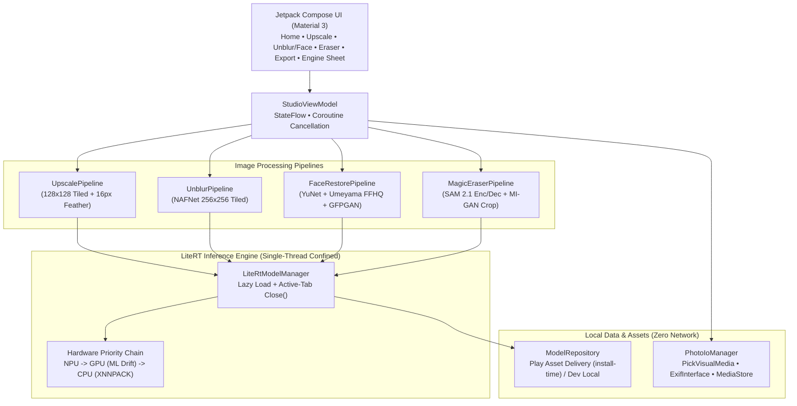

# Technical Architecture — OffPix (`com.offpix.app`)

> **Stack:** Kotlin • Jetpack Compose (Material 3) • Standalone Google LiteRT (`CompiledModel`) • Play Asset Delivery (`install-time`) • `ExifInterface` • `MediaStore`

---

## 1. High-Level System Architecture

The app follows **Clean MVVM + Unidirectional Data Flow (UDF)** with strict separation between the Compose UI, image-processing domain pipelines, and the single-threaded LiteRT inference engine.



---

## 2. Gradle Module Structure

```text
offpix/
├── settings.gradle.kts              # Includes :app and :pack_models
├── build.gradle.kts                 # Kotlin, AGP, Compose compiler plugins
├── gradle/libs.versions.toml        # Version catalog
├── app/
│   ├── build.gradle.kts             # minSdk=26, targetSdk=35, assetPacks = setOf(":pack_models")
│   └── src/main/
│       ├── AndroidManifest.xml      # ZERO INTERNET permission
│       └── kotlin/com/offpix/app/
│           ├── MainActivity.kt
│           ├── ui/
│           │   ├── theme/           # Dark Studio Material 3 theme (matches prototype)
│           │   ├── home/            # HomeScreen, RecentRescuesStrip
│           │   ├── editor/          # EditorScreen, BeforeAfterSlider, ProcessingHud
│           │   ├── tabs/            # UpscaleControls, UnblurControls, EraserControls, MaskCanvas
│           │   └── sheets/          # ExportSheet, EngineLicensesSheet
│           ├── viewmodel/
│           │   ├── StudioViewModel.kt
│           │   └── StudioUiState.kt
│           ├── ml/
│           │   ├── LiteRtRuntime.kt       # Standalone LiteRT Environment + NPU->GPU->CPU fallback
│           │   ├── ModelRepository.kt     # Resolves .tflite files from PAD or local dev cache
│           │   ├── TensorUtils.kt         # Bitmap <-> NHWC/NCHW float buffer conversions
│           │   ├── TilingEngine.kt        # Overlapped tile extraction + cosine/linear feathering
│           │   ├── RealEsrganRunner.kt
│           │   ├── NafnetRunner.kt
│           │   ├── YuNetDetector.kt
│           │   ├── FaceAligner.kt         # Umeyama 5-point similarity warp + inverse paste-back
│           │   ├── GfpganRunner.kt
│           │   ├── Sam2Runner.kt          # Encoder cache + per-tap Decoder
│           │   └── MiganInpainter.kt      # Bounding-box crop + 4-ch pack + feathered composite
│           └── io/
│               ├── PhotoLoader.kt         # PickVisualMedia Uri + EXIF upright rotation + RAM cap
│               └── PhotoSaver.kt          # MediaStore JPEG/PNG export + EXIF tag preservation
└── pack_models/                     # Play Asset Delivery (install-time, ~290-330 MB)
    ├── build.gradle.kts             # com.android.asset-pack (deliveryType = "install-time")
    └── src/main/assets/models/      # .tflite files (git-ignored, fetched via scripts/fetch_models.py)
```

---

## 3. Key Architectural Decisions

### 3.1 Standalone LiteRT (`com.google.ai.edge.litert`) vs. Play Services LiteRT
- **Decision:** Use **Standalone LiteRT (`com.google.ai.edge.litert:litert:2.3.0` + `litert-gpu:2.3.0`)** behind a thin `LiteRtRuntime` interface.
- **Why:**
  1. Adds only ~8–10 MB to a ~312 MB app (negligible).
  2. **Zero Google Play Services dependency** — works identically on every Android phone including de-Googled privacy devices (GrapheneOS, LineageOS, sideloaded APKs).
  3. Supports the full `CompiledModel` API with deterministic `NPU → GPU (ML Drift) → CPU (XNNPACK)` fallback.
  4. Swapping to `play-services-litert:17.0.0` later is a 5-line change in `LiteRtRuntime.kt` if ever desired.

### 3.2 Play Asset Delivery: `install-time` Pack
- **Decision:** Bundle all 6 models (~290–330 MB) in one `install-time` asset pack (`:pack_models`).
- **Why:**
  1. Google Play's `install-time` asset pack limit is **1.5 GB** — our ~300 MB pack fits easily.
  2. Users tap **Install** once on Play Store and the app is **100% offline from second zero** — no in-app download dialogs, no `WAITING_FOR_WIFI` stalls in airplane mode, and **zero `INTERNET` permission** required in the manifest.
  3. Keep `androidResources { noCompress += listOf("tflite", "litertlm") }` so models can be memory-mapped directly without decompressing into RAM.

### 3.3 Memory & Thread Safety (Preventing OOM on 4 GB Phones)
1. **Single-Thread Inference Dispatcher:** All `CompiledModel` creation, `run()`, and `close()` calls execute on a single dedicated thread (`Executors.newSingleThreadExecutor().asCoroutineDispatcher()`) to prevent OpenCL/Vulkan GPU context races.
2. **Exclusive Active-Tab Model Lifecycle:** Only the active tab's model(s) stay loaded in memory. Switching from *Unblur & Face* to *Magic Eraser* immediately calls `close()` on GFPGAN/NAFNet before loading SAM 2.1.
3. **Reusable `TensorBuffer`s:** Input and output buffers are allocated once per model load and reused across every tile in Real-ESRGAN and NAFNet loops (zero GC thrashing).
4. **RAM-Aware Resolution Guardrails (`ActivityManager.MemoryInfo`):**
   - Devices with `totalMem <= 6 GB`: Cap 4x Upscale input longest edge at **1024 px** (max output `4096×4096`, ~64 MB RGBA).
   - Devices with `totalMem > 6 GB`: Allow input longest edge up to **1536 px** (max output `6144×6144`).
   - Always recycle intermediate `Bitmap`s immediately after compositing.

### 3.4 Storage & Privacy Architecture
- **Reading Photos:** `ActivityResultContracts.PickVisualMedia(ImageOnly)` — zero `READ_MEDIA_IMAGES` permission needed.
- **Orientation & EXIF:** Decode via `ContentResolver.openInputStream(uri)`, read `ExifInterface.TAG_ORIENTATION` to rotate upright before inference, and retain safe EXIF tags (DateTime, Make, Model, FocalLength, ExposureTime, ISO) to copy onto the exported file if "Preserve EXIF" is checked.
- **Saving Photos:** Write to `MediaStore.Images.Media.EXTERNAL_CONTENT_URI` with `RELATIVE_PATH = "Pictures/PocketPhotoRescue"` on API 29+ (zero permissions). For API 26–28, request legacy `WRITE_EXTERNAL_STORAGE` only at save time.
- **Zero Network:** Explicitly omit `android.permission.INTERNET` and `ACCESS_NETWORK_STATE` from `AndroidManifest.xml`.
